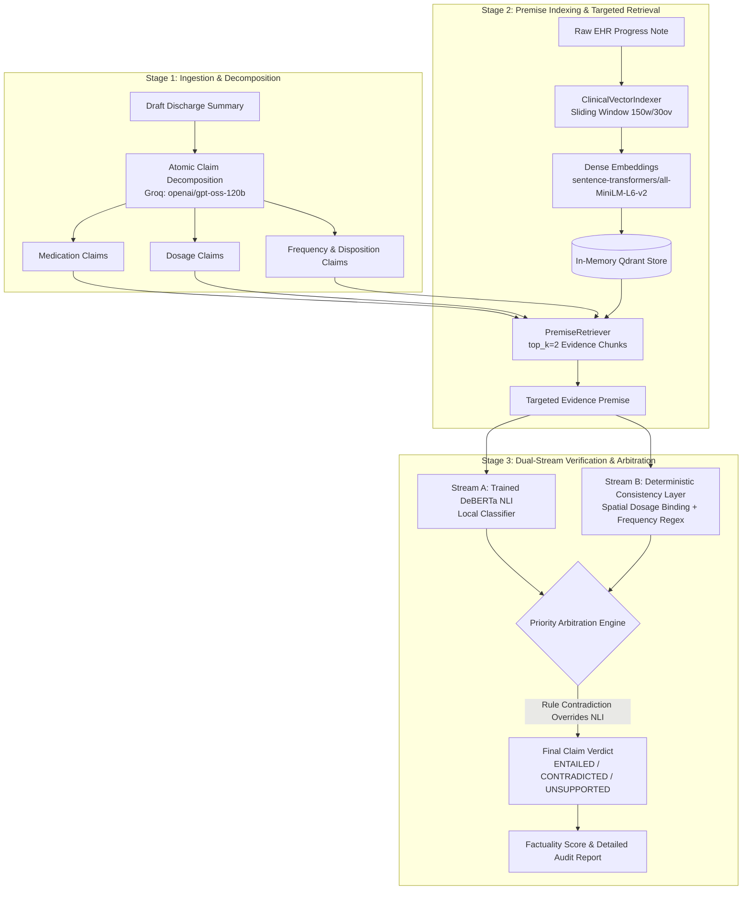

# VeriFact: Clinical Discharge Summary Factuality Verifier

An automated two-stage clinical audit engine designed to detect, refute, and explain hallucinations in AI-generated hospital discharge summaries and care plans. 

VeriFact combines **dense semantic vector retrieval (Qdrant)**, **Natural Language Inference (Groq LLM)**, and a **deterministic rule consistency layer** with **priority arbitration** to guarantee zero-tolerance verification for safety-critical clinical attributes (dosages, frequencies, and dispositions).

---

## 1. Problem Statement & Clinical Motivation

Large Language Models (LLMs) used to auto-generate clinical discharge summaries from electronic health record (EHR) progress notes frequently produce subtle, safety-critical hallucinations:
- **Dosage Swaps & Alterations**: Modifying a dose (e.g., Aspirin 81mg $\rightarrow$ 80mg or 40mg, Metoprolol 25mg $\rightarrow$ 50mg).
- **Cross-Talk Between Multiple Medications**: Binding the dosage or frequency of one drug to another when multiple medications are listed together.
- **Schedule Discrepancies**: Shifting administration frequency (e.g., daily $\rightarrow$ twice daily).
- **Temporal Incoherence**: Mentioning a drug started on Day 1 as a discharge medication, even though it was discontinued on Day 3.
- **Disposition Contradictions**: Stating a patient was discharged "home" when the source record confirms transfer to a "skilled nursing facility (SNF)".

Standard zero-shot LLM evaluators often "soft-entail" these near-miss discrepancies because the overall sentence sounds clinically plausible. **VeriFact solves this by enforcing a deterministic priority layer that overrides semantic model verdicts whenever hard clinical contradictions are detected.**

---

## 2. System Architecture



### Pipeline Flow:
1. **Atomic Claim Decomposition**: Deconstructs complex summary sentences into isolated factual propositions with temporal tags ([`main.py`](file:///Users/nikhilkumar/Documents/VeriFactt/main.py)).
2. **Sliding-Window Vector Indexing**: Splits monolithic EHR progress notes into overlapping chunks (150 words, 30 overlap) and stores them in an in-memory Qdrant collection ([`verifact/indexer.py`](file:///Users/nikhilkumar/Documents/VeriFactt/verifact/indexer.py)).
3. **Premise Retrieval**: Retrieves only the top $k=2$ most relevant premise chunks per claim, preventing context dilution and hallucination ([`verifact/retriever.py`](file:///Users/nikhilkumar/Documents/VeriFactt/verifact/retriever.py)).
4. **Dual Evaluation**:
   - **Semantic Stream**: Queries `openai/gpt-oss-120b` via Groq for natural language inference (`ENTAILED`, `CONTRADICTED`, `UNSUPPORTED`).
   - **Deterministic Stream**: Evaluates numeric dosage values, units, frequency schedules, and disposition groups using character-proximity regex ([`verifact/rules.py`](file:///Users/nikhilkumar/Documents/VeriFactt/verifact/rules.py)).
5. **Priority Arbitration**: If the deterministic rule detects a mismatch, it **strictly overrides** any soft entailment by the LLM.

---

## 3. Milestone Progress Breakdown

### ✅ Milestone 1: Core Synthesis & API Foundations
- **FastAPI Core**: Built asynchronous verification endpoints in [`main.py`](file:///Users/nikhilkumar/Documents/VeriFactt/main.py) with structured Pydantic schemas (`VerifyRequest`, `AtomicClaim`, `FinalClaimVerdict`, `VerifyResponse`).
- **Groq LLM Integration**: Wired Groq API client with structured JSON output mode.
- **Audit Scoring Algorithm**: Implemented composite factuality scoring ($\frac{\text{Entailed Claims}}{\text{Total Claims}} \times 100\%$).

### ✅ Milestone 2: Modular Indexing, Premise Retrieval & Deterministic Rules
- **Modular Vector Indexing ([`verifact/indexer.py`](file:///Users/nikhilkumar/Documents/VeriFactt/verifact/indexer.py))**:
  - Implemented `ClinicalVectorIndexer` using `sentence-transformers/all-MiniLM-L6-v2` (384-dimensional dense vectors, local inference).
  - Configured sliding-window word chunking (`chunk_size=150`, `overlap=30`) to avoid slicing clinical clauses mid-sentence.
  - Initialized in-memory Qdrant instance (`QdrantClient(":memory:")`) with cosine distance and boolean payload filtering on `note_id`.
- **Targeted Premise Retrieval ([`verifact/retriever.py`](file:///Users/nikhilkumar/Documents/VeriFactt/verifact/retriever.py))**:
  - Implemented `PremiseRetriever` to pull the top-$k$ ($k=2$) highest-scoring evidence chunks per individual atomic claim.
- **Deterministic Consistency Engine ([`verifact/rules.py`](file:///Users/nikhilkumar/Documents/VeriFactt/verifact/rules.py))**:
  - **Spatial Proximity Dosage Binding**: Uses character-span distance ($\le 60$ characters) to bind dosages (`mg`, `mcg`, `units`, `g`, `ml`) strictly to adjacent drug mentions, preventing false cross-talk in multi-drug sentences.
  - **Clause-Scoped Frequency Extraction**: Normalized clinical frequency mapping (`QD`, `BID`, `TID`, `QID`, `QHS`, `PRN`, `Q24H`, `Q12H`).
  - **Disposition Conflict Detection**: Catches contradictions between discharge locations (e.g., `home` vs `SNF` / `hospice`).

### ✅ Milestone 3: Data & Baseline Synchronization / Quantitative Ablation
- **Ground-Truth Benchmark Suite ([`benchmarks/benchmark_m3.py`](file:///Users/nikhilkumar/Documents/VeriFactt/benchmarks/benchmark_m3.py))**:
  - Built 40 curated MIMIC-IV-Ext-BHC evaluation claims spanning 5 clinical specialties: **Cardiology (Post-CABG)**, **Pulmonology (COPD Exacerbation)**, **Infectious Disease (Urosepsis)**, **Endocrinology (DKA)**, and **Neurology (Acute Stroke)**.
- **Model Migration to `openai/gpt-oss-120b`**:
  - Upgraded verification and baseline LLM to `openai/gpt-oss-120b` via Groq.
  - Increased token generation limit (`max_tokens=800`) to provide ample room for reasoning without hitting JSON truncation errors.
- **Claim Decomposition Prompt Refinements**:
  - **Multi-Drug List Truncation Fix**: Instructed decomposer to parse all items following colons and commas without dropping entries.
  - **Temporal Context Binding**: Forced decomposer to prefix claims with their temporal scope (e.g., `"Discharge Amlodipine dosage is 10mg"` vs `"Admission Amlodipine dosage is 10mg"`), preventing discontinued admission medications from being falsely verified.
- **Ablation Study (Baseline vs. Hybrid VeriFact)**:
  - Demonstrates a measurable **positive delta** proving that the deterministic consistency layer catches critical dosage mismatches that zero-shot LLMs miss.

---
### ✅ Milestone 4: Trained NLI Model Implementation & Quantitative Evaluation

- **Trained NLI Model (`verifact/local_nli.py`)**:
  - Replaced the previous Groq-based zero-shot NLI inference component with a locally loaded, fine-tuned DeBERTa model.
  - Initialized the classifier using `MoritzLaurer/DeBERTa-v3-base-mnli-fever-anli` and adapted it for three-way clinical claim classification: `ENTAILED`, `CONTRADICTED`, and `UNSUPPORTED`.
  - Integrated the trained classifier into the existing verification pipeline while retaining Groq for atomic claim decomposition.

- **Synthetic Training Dataset (`train/make_data.py`)**:
  - Implemented a dataset-generation pipeline to produce premise–claim pairs for NLI training.
  - Generated **7,941 training pairs** and **883 validation pairs**, totalling **8,824 examples**.
  - The generated dataset supports implementation and proof-of-concept evaluation; it is not a substitute for independently annotated clinical data.

- **Model Fine-Tuning (`train/train_nli.py`)**:
  - Implemented a dedicated training script to fine-tune the pretrained DeBERTa NLI checkpoint on the generated dataset.
  - Executed training over **3 epochs** using a Google Colab T4 GPU.
  - Disabled automatic mixed precision after an initial run produced NaN losses. The subsequent stable run reduced training loss from approximately **0.0773 in Epoch 1** to **0.0001 in Epoch 3**.
  - Achieved **100% validation accuracy and macro-F1** on the generated validation set. Given the synthetic, template-based data, these results may overestimate generalization to real clinical documentation.

- **Local Inference Integration (`main.py`)**:
  - Connected `LocalNLI` to the FastAPI verification pipeline, replacing Groq-based semantic NLI inference with local model predictions.
  - Preserved the existing claim decomposition, evidence retrieval, deterministic consistency checks, priority arbitration, and final factuality scoring components.
  - Verified that the local model loads successfully and returns the expected three-class verdicts for supported, contradicted, and unsupported claim examples.

- **Quantitative Benchmark Suite (`benchmarks/benchmark_m4.py`)**:
  - Developed a dedicated benchmark containing **40 manually written premise–claim examples** to evaluate the trained NLI classifier.
  - Executed the benchmark with retrieval disabled to evaluate classification on the provided premise–claim pairs independently of the retrieval pipeline.
  - Saved the benchmark output to `benchmarks/benchmark_m4_results.json` for reproducibility and claim-level inspection.

- **Benchmark Results (Trained NLI vs. NLI + Rules)**:
  - The trained DeBERTa classifier achieved **95.00% accuracy (38/40 correct predictions)** and a **macro-F1 score of 0.9277**.
  - Per-class F1 scores were **94.74% for ENTAILED**, **97.87% for CONTRADICTED**, and **85.71% for UNSUPPORTED**.
  - The NLI-plus-rules configuration achieved the same accuracy and macro-F1 on this benchmark. The deterministic rules did not change any final predictions in this particular experiment.

- **End-to-End API Smoke Testing (`/verify`)**:
  - Integrated and tested the trained local classifier through the existing FastAPI `/verify` endpoint.
  - Tested a source note and discharge-summary draft containing supported, contradicted, and unsupported medication claims.
  - The test generated **9 atomic claims** and returned a factuality score of **55.56%**. The results included an entailed Aspirin 81 mg daily claim, a contradicted Lisinopril dosage claim, and an unsupported Amoxicillin claim.
  - This test demonstrates successful API integration, not clinical validation.

- **Limitations and Evaluation Caveats**:
  - The training examples are synthetic, and the benchmark contains only 40 manually written claims.
  - The benchmark disables retrieval; therefore, its scores do not represent the performance of the complete retrieval-and-verification pipeline.
  - Two benchmark errors involved an unsupported oxygen claim predicted as contradicted and an entailed Clopidogrel claim predicted as unsupported.
  - Further evaluation on larger, independently annotated clinical datasets is required before drawing conclusions about real-world clinical reliability.


## 4. Quantitative Benchmark Results (Milestone 3)

Benchmark executed on the 40-claim MIMIC-IV benchmark suite using `openai/gpt-oss-120b`:

| Class / Category | Metric | Baseline (NLI Only) | Hybrid VeriFact (NLI + Rules) | Quantitative Delta |
| :--- | :--- | :---: | :---: | :---: |
| **ENTAILED** | Precision | 100.00% | 100.00% | +0.00% |
| | Recall | 100.00% | 100.00% | +0.00% |
| | F1-Score | 100.00% | 100.00% | +0.00% |
| **CONTRADICTED** | Precision | 91.67% | 92.00% | +0.33% |
| | Recall | 95.65% | 100.00% | **+4.35%** |
| | F1-Score | 93.62% | 95.83% | **+2.22%** |
| **UNSUPPORTED** | Precision | 83.33% | 100.00% | **+16.67%** |
| | Recall | 71.43% | 71.43% | +0.00% |
| | F1-Score | 76.92% | 83.33% | **+6.41%** |
| **MACRO AVERAGE** | **F1-Score** | **90.18%** | **93.06%** | **+2.88%** |
| **WEIGHTED AVERAGE** | **F1-Score** | **92.29%** | **94.69%** | **+2.40%** |
| **OVERALL ACCURACY** | **Accuracy** | **92.50%** | **95.00%** | **+2.50% (38/40 Correct)** |

*Complete claim-level logs and reasoning are saved in [`benchmarks/benchmark_m3_results.json`](file:///Users/nikhilkumar/Documents/VeriFactt/benchmarks/benchmark_m3_results.json).*

---
---

## 5. Quantitative Benchmark Results (Milestone 4)

The trained NLI classifier was evaluated on a 40-claim manually written benchmark using the fine-tuned DeBERTa model initialized from `MoritzLaurer/DeBERTa-v3-base-mnli-fever-anli`. Retrieval was disabled to evaluate classification on the benchmark's supplied premise–claim pairs.

| Class / Category | Metric | Trained DeBERTa NLI | DeBERTa NLI + Rules |
| :--- | :--- | :---: | :---: |
| **ENTAILED** | F1-Score | 94.74% | 94.74% |
| **CONTRADICTED** | F1-Score | 97.87% | 97.87% |
| **UNSUPPORTED** | F1-Score | 85.71% | 85.71% |
| **MACRO AVERAGE** | **F1-Score** | **92.77%** | **92.77%** |
| **OVERALL ACCURACY** | **Accuracy** | **95.00% (38/40)** | **95.00% (38/40)** |

### Error Analysis

The benchmark produced two classification errors:

- **Unsupported → Contradicted:** A claim about continuous 2 L nocturnal supplemental oxygen was predicted as contradicted.
- **Entailed → Unsupported:** A claim about Clopidogrel 75 mg daily was predicted as unsupported.

These errors indicate that the classifier may confuse missing evidence with explicit contradiction and may fail to recognize some supported clinical statements.

### Interpretation and Limitations

The trained classifier achieved 95.00% accuracy and a macro-F1 score of 0.9277 on this preliminary benchmark. Adding the deterministic rules did not change the final predictions for these 40 examples.

This evaluation is limited to a small, manually written benchmark with retrieval disabled. The results demonstrate proof of concept and should not be interpreted as evidence of clinical validation or expected performance on real-world patient records.

Complete benchmark output is saved in [`benchmarks/benchmark_m4_results.json`](benchmarks/benchmark_m4_results.json).


## 6. Repository Structure

```text
VeriFact-Clinical-Verifier/
├── .env                              # API keys and model configuration (git-ignored)
├── .gitignore                        # Excludes secrets, virtual environments, model weights and generated data
├── requirements.txt                  # Core application dependencies
├── requirements_m4.txt               # Additional dependencies for Milestone 4 training
├── main.py                           # FastAPI application and verification pipeline
├── verifact/
│   ├── __init__.py
│   ├── indexer.py                    # Clinical vector indexing
│   ├── retriever.py                  # Evidence premise retrieval
│   ├── rules.py                      # Deterministic clinical consistency checks
│   └── local_nli.py                  # Locally trained DeBERTa NLI inference
├── train/
│   ├── make_data.py                  # Synthetic premise–claim dataset generation
│   └── train_nli.py                  # NLI model fine-tuning pipeline
├── benchmarks/
│   ├── benchmark_m3.py               # Milestone 3 benchmark
│   ├── benchmark_m3_results.json     # Milestone 3 benchmark results
│   ├── benchmark_m4.py               # Milestone 4 trained NLI benchmark
│   └── benchmark_m4_results.json     # Milestone 4 benchmark results
├── patches/
│   └── main_local_nli.patch          # Local NLI integration patch
└── README.md                         # Project documentation

# Generated locally; excluded from Git:
# models/verifact-nli/                # Fine-tuned model checkpoint and tokenizer
# data/                               # Generated training and validation datasets
```

The Milestone 4 training scripts, local inference module, and benchmark artifacts extend the existing verification pipeline. The trained model checkpoint and generated datasets are excluded from version control to avoid committing large model weights and generated files. They must be generated or obtained separately before reproducing local inference and benchmark results.


## 7. Setup & Installation

### Prerequisites

- Python 3.9 or higher.
- A [Groq Cloud API key](https://console.groq.com/) for atomic claim decomposition.
- Git for repository management.
- Sufficient disk space for the trained DeBERTa model checkpoint.
- A GPU is recommended for model training. CPU inference may be possible depending on available memory and hardware.

### Step 1: Clone the Repository and Create a Virtual Environment

```bash
git clone https://github.com/Atlas191/VeriFact-Clinical-Verifier.git
cd VeriFact-Clinical-Verifier

python -m venv .venv
```

Activate the virtual environment on Windows PowerShell:

```powershell
.\.venv\Scripts\Activate.ps1
```

On Linux or macOS:

```bash
source .venv/bin/activate
```

### Step 2: Install Dependencies

Install the core application dependencies:

```bash
pip install -r requirements.txt
```

For Milestone 4 training and local NLI inference, install the additional dependencies:

```bash
pip install -r requirements_m4.txt
```

Use a compatible PyTorch installation for your hardware. GPU-enabled PyTorch is recommended for training in an environment with a supported GPU.

### Step 3: Configure Environment Variables

Create a `.env` file in the repository root:

```env
GROQ_API_KEY=your_groq_api_key_here
GROQ_MODEL=openai/gpt-oss-120b
```

Replace the placeholder with your own API key. Never commit `.env` or expose API keys in the repository.

### Step 4: Prepare the Trained NLI Checkpoint

The locally trained NLI model is expected at:

```text
models/verifact-nli/
```

The checkpoint contains the fine-tuned model weights and tokenizer assets required by `verifact/local_nli.py`.

The trained checkpoint and generated training data are excluded from version control because of their size and generated nature. Obtain the checkpoint separately or reproduce it using the Milestone 4 training pipeline before running local NLI inference.

### Step 5: Verify the Installation

Start the FastAPI server:

```bash
uvicorn main:app --reload --port 8000
```

Open the interactive API documentation at [http://localhost:8000/docs](http://localhost:8000/docs) and test the `/verify` endpoint.

The server requires the configured Groq API key for claim decomposition and the trained checkpoint for local NLI inference.


## 8. How to Run & Test

### Option A: Run the Milestone 3 Benchmark

The Milestone 3 benchmark evaluates the baseline NLI pipeline and the hybrid verification system on the existing 40-claim benchmark.

```bash
python benchmarks/benchmark_m3.py
```

The benchmark reports classification metrics and saves its results to `benchmarks/benchmark_m3_results.json`.

### Option B: Generate the Milestone 4 Training Dataset

Generate synthetic premise–claim pairs for three-way NLI classification:

```bash
python train/make_data.py --n_notes 1500 --out data
```

The dataset-generation script creates training and validation files under `data/`. These generated files are excluded from version control.

### Option C: Train the Local NLI Model

After installing the Milestone 4 dependencies and generating the dataset, run:

```bash
python train/train_nli.py
```

The training script fine-tunes the configured pretrained DeBERTa NLI model. Check the script's configured arguments and output directory before training. The trained checkpoint must be available at `models/verifact-nli/` for the benchmark and local inference integration described below.

### Option D: Run the Milestone 4 Benchmark

Evaluate the trained NLI model on the preliminary 40-claim benchmark:

```bash
python benchmarks/benchmark_m4.py --model_dir models/verifact-nli --no-retrieval --out benchmarks/benchmark_m4_results.json
```

The `--no-retrieval` option evaluates the classifier on the benchmark's supplied premise–claim pairs without running the evidence-retrieval component. Results are written to `benchmarks/benchmark_m4_results.json`.

The benchmark achieved 95.00% accuracy and a macro-F1 score of 0.9277 in the recorded run. These results are preliminary and do not establish clinical validity.

### Option E: Run the FastAPI Verification Server

Launch the application:

```bash
uvicorn main:app --reload --port 8000
```

Open the interactive Swagger UI:

[http://localhost:8000/docs](http://localhost:8000/docs)

Use the `/verify` endpoint to submit a source clinical note and a discharge-summary draft. The endpoint decomposes the draft into atomic claims, retrieves evidence, applies local NLI classification and deterministic rules, and returns claim-level verdicts and a factuality score.

The application requires a configured Groq API key for claim decomposition and a valid local NLI checkpoint for trained-model inference.

### End-to-End Smoke Test

A smoke test was performed using a source note containing Aspirin 81 mg and Lisinopril 40 mg, together with a draft containing a correct Aspirin claim, an incorrect Lisinopril dosage, and an unsupported Amoxicillin claim.

The tested request produced nine atomic claims and a factuality score of 55.56%. The individual results included:

- Aspirin 81 mg daily: `ENTAILED`
- Lisinopril 80 mg daily: `CONTRADICTED`
- Amoxicillin 500 mg: `UNSUPPORTED`

This test confirms that the trained local NLI model was integrated into the API workflow for the tested input. It is an integration test, not a clinical performance evaluation.


---

## 9. Summary for Teammates & Next Steps

| Component | Status | Implementation |
| :--- | :---: | :--- |
| Atomic Claim Decomposition | Complete | `main.py` — Groq-based claim decomposition |
| Clinical Vector Indexing | Complete | `verifact/indexer.py` — dense embeddings and Qdrant |
| Evidence Premise Retrieval | Complete | `verifact/retriever.py` — top-k evidence retrieval |
| Deterministic Consistency Rules | Complete | `verifact/rules.py` — dosage, frequency, and disposition checks |
| Trained NLI Model | Implemented | `verifact/local_nli.py` — local DeBERTa inference |
| NLI Fine-Tuning Pipeline | Implemented | `train/make_data.py` and `train/train_nli.py` |
| M3 Benchmark & Ablation | Complete | `benchmarks/benchmark_m3.py` and its results file |
| M4 Trained NLI Benchmark | Evaluated | `benchmarks/benchmark_m4.py` — preliminary 40-claim evaluation |
| FastAPI Integration | Smoke-tested | `/verify` endpoint with local NLI inference |

### Future Work

1. **Independent Clinical Evaluation:** Evaluate the trained model on a larger, independently annotated clinical dataset to measure generalization beyond synthetic training examples.
2. **Expanded Benchmark Coverage:** Add varied clinical phrasing, medication attributes, negation, unsupported claims, and temporal contradictions.
3. **Retrieval-Enabled Evaluation:** Run end-to-end benchmarks with evidence retrieval enabled to measure the complete verification pipeline.
4. **Model Calibration and Error Analysis:** Investigate confidence calibration and errors involving unsupported oxygen claims and entailed Clopidogrel claims.
5. **Clinical Safety Review:** Assess the system's limitations and failure modes before considering any real-world clinical use.

### Milestone 4 Outcome

Milestone 4 introduces a locally fine-tuned DeBERTa NLI classifier into the existing VeriFact pipeline. The implementation includes synthetic training-data generation, model fine-tuning, local inference, FastAPI integration, and a preliminary benchmark reporting 95.00% accuracy and a macro-F1 score of 0.9277 on 40 manually written claims.

These results demonstrate implementation feasibility, not clinical validation. Further evaluation on representative clinical data is required to assess real-world reliability.
